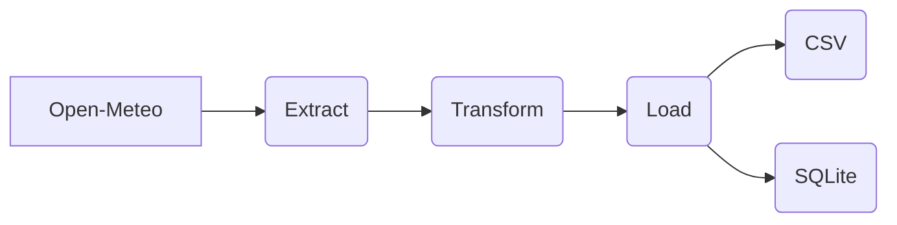
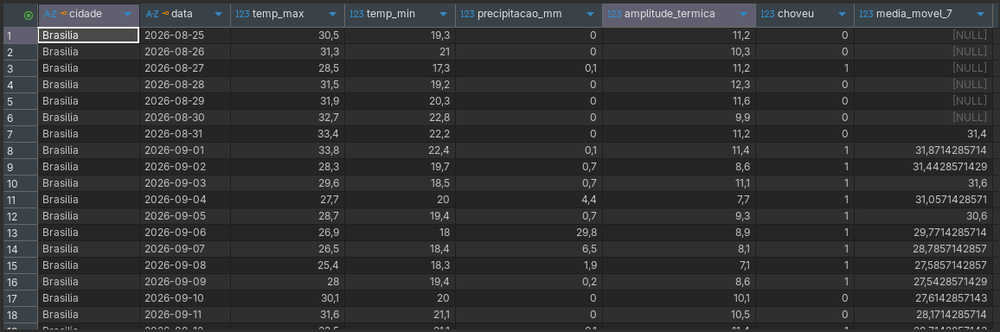

# Open-Meteo ETL
Pipeline ETL para extrair dados de temperatura e precipitação de várias cidades, transformar calculando amplitude térmica, média móvel de 7 dias e registrar se choveu ou não para cada dia. 
Fonte: [Open-Meteo Historical API](https://open-meteo.com/en/docs/historical-weather-api)

## Fluxo de funcionamento:


## Como rodar:
No terminal:
```
git clone <url-do-repositorio>
cd <pasta>
python -m venv venv
source venv/bin/activate   # Windows: venv\Scripts\activate
pip install -r requirements.txt
python climate_etl.py
```

## Configurando cidades e data:
No topo do código há 3 variáveis, um dicionário 'cidades' com cinco cidades e suas respectivas coordenadas geográficas; 'data_start' com a data de início do período; 'data_end' com a data final do período a ser pesquisado.
Nas datas, ambas são no formato 'YYYY-MM-DD', poderá escolher a data que desejar, desde que a 'data_start' seja menor que a 'data_end'.
Para mudar a cidade, pesquise a latitude e longitude da cidade que deseja e adicione (ou substitua alguma) no dicionário. A formatação é sempre a seguinte: 
``{'CIDADE': {'latitude': 'LATITUDE', 'longitude': 'LONGITUDE'}} ``
Os valores em maiúsculas (CIDADE, LATITUDE, LONGITUDE) são os que podem ser alterados

## Arquivos:
São gerados os seguintes arquivos quando a pipeline é executada:
```
clima.csv #o csv com todos os dados da tabela
clima.db #o banco de dados no sqlite
code_log.txt #o registro de todos os passos e erros (se houver)
```

## Saída:


## Limitações:
- Em versões futuras desejo modificar a coluna média móvel, para que, rodando pela segunda vez em diante com novas datas de início e fim, os dados já existentes na tabela possam ser usados para o cálculo de média. Esse problema está acontecendo tanto no banco quanto no arquivo CSV.
- As datas ainda são fixas no código, o que não fica tão intuitivo.
- Uma precipitação nula retorna um falso negativo na coluna 'choveu'.

## Decisões de design:
Aqui buscamos somente dados históricos ao invés de previsões, por conta das colunas 'choveu' e 'media_movel_7' 
A tabela no banco de dados é criada com uma chave primária composta das colunas 'cidade' e 'data' para que seja possível evitar duplicatas, quando a pipeline rodar com datas que já estão registradas no banco, o ``ON CONFLICT(cidade, data) DO NOTHING`` vai descartar os registros repetidos.
O mesmo acontece no load para CSV, a função verifica se já existe um arquivo csv, colocando os dados em uma variável ou criando um dataframe vazio. Coloca os dados novos em uma variável separada e concatena as duas, utilizando o ``drop_duplicates`` utilizando novamente as colunas 'cidade' e 'data' como chaves.

## O que aprendi:
Esse projeto me fez ver uma ETL de uma forma muito mais esclarecedora, consigo entender melhor as fases de funcionamento, lógicas que eu tinha dificuldade agora já aparecem com mais fluidez... Acredito que no próximo vou conseguir realizar com menos dificuldade.
